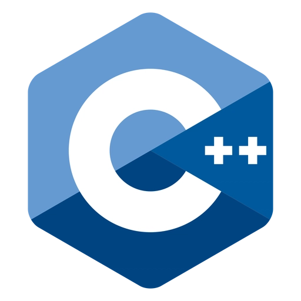
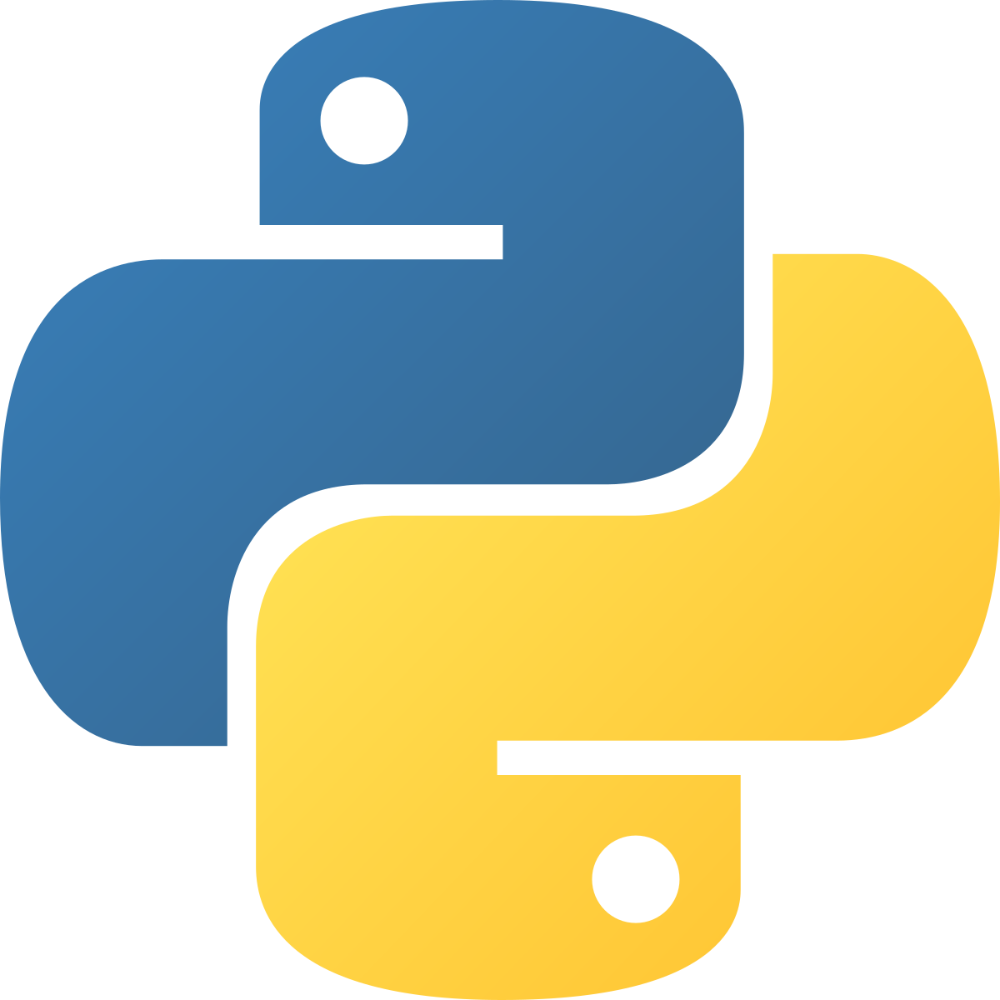
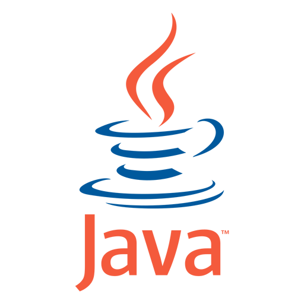
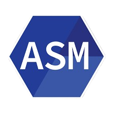
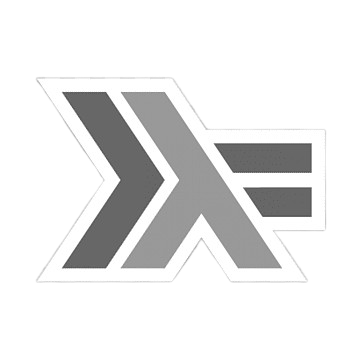
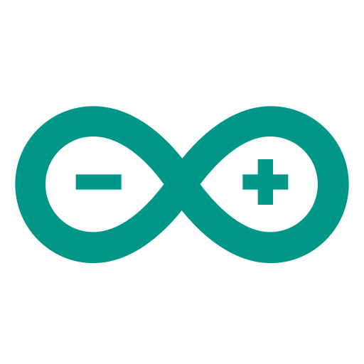

### 👨‍💻 Sobre Mim

- 🎓 Computer Engineering Student at the Federal University of Sergipe (UFS), Brazil.
- � Technical Degree in Electrotechnics from the Federal Institute of Sergipe (IFS).
- 🌟 Experience in C, C++,Java,Haskell, Assembly, and Verilog.
- 📘 Currently learning Data Structures, MIPS Assembly, and Digital System Design.
- � Passionate about hardware, software integration, and low-level programming.

### 🌎 Onde me achar

    
    

---

### 🛠️ Habilidades

Aqui estão algumas das tecnologias e linguagens com as quais tenho trabalhado:

    <a href="https://skillicons.dev">
        
        
        
        
        
        
        
    </a>

  

